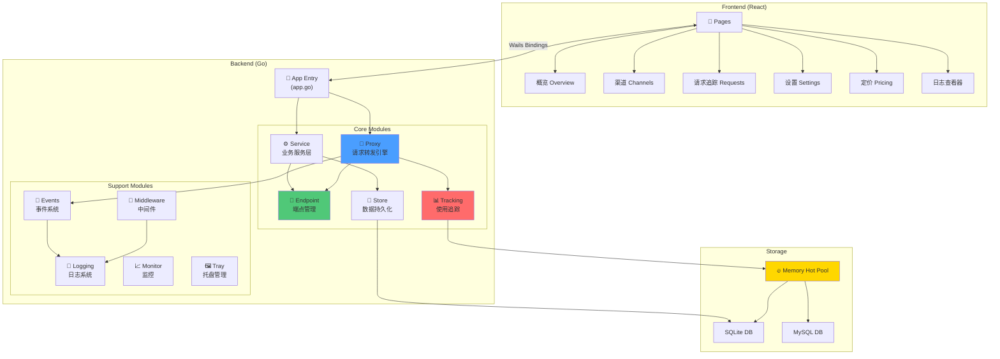

# CLAUDE.md

本文件为 Claude Code 提供项目指导信息。

> 📅 **最后更新**: 2026-05-27
> 🏗️ **架构版本**: v7.3
> 📦 **模块数量**: 17 个核心模块（9 个后端 + 8 个前端）

## 项目概述

**AI Relay Forwarder** 是一款基于 Wails 构建的跨平台桌面应用，用于多 AI 提供商 API 请求的智能中继转发、负载均衡和故障恢复。

- **当前版本**: v8.1
- **技术栈**: Go + Wails v3 + React + Vite
- **支持平台**: macOS / Windows / Linux

### 核心功能

- 多端点智能路由与优先级调度
- 自动故障转移与端点自愈
- **故障转移策略 v2** - `loop_retry` 开关 + `max_loops` 循环重试上限
- 请求生命周期追踪与状态管理
- 流式响应处理（SSE）
- **计费感知重试** - 基于 Token 计费智能判断错误可重试性
- 内存热池架构优化数据库写入
- **SQLite 持久化** - 单文件数据库（MySQL 支持已在 v4.1 移除）
- **可视化设置界面** - 枚举类型支持、变更追踪、实时生效

## 快速开始

```bash
# 开发模式运行
wails3 dev

# 构建当前平台
wails3 task build

# 仅构建后端（开发调试用）
wails3 task dev:build

# 运行测试
go test ./...
```

## 项目结构

```
claude-request-forwarder-desktop/        # 注：仓库已更名为 AI-Relay-Forwarder
├── main.go                 # Wails 应用入口
├── globals.go              # 全局变量和共享函数
├── app.go                  # 主应用逻辑，绑定前端 API
├── app_api_*.go           # 前端 API 接口模块
├── Taskfile.yml           # Wails v3 构建配置
├── frontend/              # React 前端
│   ├── src/
│   │   ├── pages/         # 页面组件
│   │   │   ├── overview/  # 概览页面
│   │   │   ├── endpoints/ # 端点管理
│   │   │   ├── requests/  # 请求追踪
│   │   │   ├── settings/  # 设置页面
│   │   │   └── ...
│   │   └── wailsjs/       # Wails 自动生成的绑定
│   └── dist/              # 构建输出
├── internal/              # 核心业务逻辑
│   ├── proxy/             # 请求转发引擎
│   │   ├── handler.go     # HTTP 请求协调器
│   │   ├── handlers/      # 专用处理器（streaming/regular）
│   │   ├── response/      # 响应处理与 Token 分析
│   │   ├── lifecycle_manager.go  # 状态机生命周期管理
│   │   └── error_recovery.go     # 智能错误恢复
│   ├── endpoint/          # 端点管理与健康检查
│   ├── tracking/          # 使用量追踪与数据库
│   │   ├── hot_pool.go    # 内存热池
│   │   ├── archive_manager.go    # 归档管理器
│   │   └── *_adapter.go   # 数据库适配器（SQLite/MySQL）
│   ├── events/            # 事件系统
│   ├── logging/           # 日志系统
│   └── service/           # 代理服务
├── config/                # 配置文件
│   ├── config.yaml        # 主配置
│   └── example*.yaml      # 配置示例
├── build/                 # 构建相关资源
│   ├── bin/               # 编译输出
│   ├── windows/           # Windows 资源
│   └── darwin/            # macOS 资源
└── docs/                  # 文档
```

## 架构全景图



## 模块索引

### 🎯 后端核心模块

| 模块 | 路径 | 职责 | 详细文档 |
|------|------|------|----------|
| **Endpoint** | `internal/endpoint/` | 端点管理、健康检查、故障转移 | [📄 CLAUDE.md](internal/endpoint/CLAUDE.md) |
| **Proxy** | `internal/proxy/` | 请求转发、流式处理、错误恢复 | [📄 CLAUDE.md](internal/proxy/CLAUDE.md) |
| **Tracking** | `internal/tracking/` | 使用追踪、热池架构、数据归档 | [📄 CLAUDE.md](internal/tracking/CLAUDE.md) |
| **Service** | `internal/service/` | 业务逻辑层（渠道/端点/定价） | [📄 CLAUDE.md](internal/service/CLAUDE.md) |
| **Store** | `internal/store/` | 数据持久化层（SQLite 访问） | [📄 CLAUDE.md](internal/store/CLAUDE.md) |
| **Events** | `internal/events/` | 事件总线系统 | 核心文件: `bus.go` |
| **Logging** | `internal/logging/` | 日志广播与事件发射 | 核心文件: `broadcast_handler.go` |
| **Middleware** | `internal/middleware/` | 认证、日志、监控中间件 | 核心文件: `auth.go` |
| **Monitor** | `internal/monitor/` | 系统监控 | 核心文件: `monitor.go` |

### 📱 前端页面模块

| 页面 | 路径 | 功能描述 | 详细文档 |
|------|------|----------|----------|
| **Overview** | `frontend/src/pages/overview/` | KPI 概览、图表展示 | [📄 CLAUDE.md](frontend/src/pages/CLAUDE.md#overview) |
| **Channels** | `frontend/src/pages/channels/` | 渠道管理、优先级配置 | [📄 CLAUDE.md](frontend/src/pages/CLAUDE.md#channels) |
| **Requests** | `frontend/src/pages/requests/` | 请求实时追踪与过滤 | [📄 CLAUDE.md](frontend/src/pages/CLAUDE.md#requests) |
| **Settings** | `frontend/src/pages/settings/` | 系统配置管理 | [📄 CLAUDE.md](frontend/src/pages/CLAUDE.md#settings) |
| **Pricing** | `frontend/src/pages/pricing/` | 模型定价管理 | [📄 CLAUDE.md](frontend/src/pages/CLAUDE.md#pricing) |
| **Log Viewer** | `frontend/src/pages/log-viewer/` | 实时日志查看器 | [📄 CLAUDE.md](frontend/src/pages/CLAUDE.md#log-viewer) |

### 🔧 配置与构建

| 类型 | 路径 | 说明 |
|------|------|------|
| **配置文件** | `config/` | YAML 配置管理 |
| **构建资源** | `build/` | 图标、manifest、平台资源 |

## 核心架构

### Wails 应用架构

```
┌─────────────────────────────────────────────────────┐
│                   Wails Runtime                      │
├─────────────────────────────────────────────────────┤
│  Frontend (React)          │    Backend (Go)        │
│  ├── Pages                 │    ├── App Struct      │
│  ├── Components            │    ├── Proxy Service   │
│  └── Wails Bindings  ←────→│    ├── Tracking        │
│                            │    └── Endpoint Mgr    │
└─────────────────────────────────────────────────────┘
```

### 请求处理流程

```
请求接收 → 端点选择 → 转发处理 → 响应分析 → 状态更新
    ↓         ↓          ↓          ↓          ↓
  Pending → Forwarding → Streaming → Processing → Completed
                    ↓
              错误恢复 → 重试/故障转移
```

### 状态机

```
业务状态: pending → forwarding → streaming → processing → completed/failed/cancelled
错误状态: retry / suspended（与业务状态独立）
```

## 配置说明

主配置文件: `config/config.yaml`

```yaml
# 代理服务
server:
  host: "127.0.0.1"
  port: 9090

# 端点配置
endpoints:
  - name: "primary"
    url: "https://api.anthropic.com"
    channel: "official"
    priority: 1
    failover_enabled: true
    token: "sk-xxx"

  - name: "backup"
    url: "https://api.example.com"
    channel: "third-party"
    priority: 2
    failover_enabled: true
    token: "sk-yyy"

# 故障转移配置
failover:
  enabled: true
  default_cooldown: "10m"

# 请求控制
request:
  # 恢复策略：所有渠道耗尽后的处理方式
  recovery_strategy: "auto_wait"  # auto_wait (推荐) | loop_retry | fail_fast

  # 智能等待参数（仅 auto_wait 策略生效）
  auto_wait_timeout: "300s"        # 最大等待时间（默认5分钟）
  auto_wait_max_requests: 100      # 最大挂起请求数（默认100）

# 内存热池（可选）
hot_pool:
  enabled: true
  max_active_requests: 1000
```

### 恢复策略详解

当所有端点都不可用时，系统提供三种恢复策略：

| 策略 | 行为 | 优点 | 缺点 | 推荐场景 |
|------|------|------|------|----------|
| **auto_wait**<br/>（智能等待） | 挂起请求，等待端点自动恢复信号（其他请求成功、冷却期到期） | 避免循环重试，减少无效请求 | 可能等待较长时间（最多 auto_wait_timeout） | **生产环境（推荐）** |
| **loop_retry**<br/>（循环重试） | 回到最高优先级渠道继续尝试（跳过冷却中的端点） | 持续尝试，不会超时 | 可能在渠道间循环重试，浪费资源 | 测试环境或渠道极少场景 |
| **fail_fast**<br/>（快速失败） | 立即返回错误，不等待恢复，不循环重试 | 明确错误信号，快速反馈 | 可能错过即将恢复的端点 | 调试环境或需要明确错误的场景 |

**向后兼容**：旧版本配置（v6.0.x 之前）会自动迁移到新的 `recovery_strategy` 格式。


## 开发命令

```bash
# 前端开发
cd frontend && npm run dev
```

### 测试策略（重要）

**⚠️ 不要直接运行 `go test ./...`！** 集成测试包含大量 `time.Sleep` 等待（累计 20-30 秒），会严重拖慢开发效率。

```bash
# ✅ 推荐：只运行修改相关的单元测试
go test ./internal/proxy/...      # 代理模块
go test ./internal/endpoint/...   # 端点管理
go test ./internal/tracking/...   # 使用量追踪
go test ./config/...              # 配置模块

# ✅ 运行特定测试函数
go test ./internal/proxy/... -run "TestErrorRecovery"

# ⏳ 集成测试（耗时较长，提交前或 CI 运行）
go test ./tests/integration/...

# 带竞态检测（完整测试时使用）
go test -race ./internal/...
```

**耗时测试文件**（仅在需要时运行）:
- `tests/integration/*_duplicate_billing_*` - 重复计费保护测试
- `tests/integration/*_streaming_*` - 流式处理测试

## 设计模式

- **状态机模式**: 请求生命周期管理
- **适配器模式**: 多数据库支持
- **工厂模式**: 请求处理器创建
- **断路器模式**: 健康检查与故障转移

## 请求透传约束（重要）

### 流式/非流请求透传规范

**核心原则：反代必须忠实透传客户端的原始请求意图，不得擅自修改请求体中的 `stream` 字段。**

**禁止行为：**
- ❌ 不得向请求体中添加 `"stream": true` 或 `"stream": false`
- ❌ 不得将非流式请求强制转为流式请求
- ❌ 不得将流式请求强制转为非流式请求

**原因：** 部分提供商（如 Anthropic 官方）会检测请求来源，若检测到非 Claude Code CLI 发出的流式请求，会返回"不准在 Claude Code 以外的 CLI 中使用"的错误响应。擅自添加 `stream` 参数会触发此类检测。

**正确处理方式：**
- 客户端发送流式请求 → 路由到支持流式的端点，原样透传
- 客户端发送非流式请求 → 路由到支持非流式的端点，原样透传
- 若端点配置了 `stream_only: true` → 该端点不参与非流式请求的端点选择

### Codex `model` 字段例外（v7.4+）

**例外规则**：`model` 字段属于「路由控制」语义，反代会按当前激活渠道的 `channel.model` 配置覆盖请求体中的 `model` 值。

**为什么算例外**：不同 Codex 服务商支持的模型名集合不同（如 `gpt-5-codex` vs `gpt-5` vs `codex-1`），全局 model 无法兼顾。通过反代按渠道改写，用户切换渠道时无需手动改全局配置。

**不影响其他字段**：除 `model` 外的所有业务字段（`stream`、`input`、`reasoning`、`tools`、`max_tokens` 等）严禁修改，仍遵循「忠实透传客户端原始请求意图」原则。

**实现位置**：
- `internal/codexproxy/model_rewriter.go` → `rewriteModelIfNeeded` 纯函数
- `internal/codexproxy/handler.go` → `ServeHTTP` 接入点

### `stream_only` 端点配置

```yaml
endpoints:
  - name: "stream-only-provider"
    url: "https://api.example.com"
    stream_only: true   # 该端点仅接受流式请求，非流请求不会路由到此端点
```

**实现位置：**
- `config/config.go` → `EndpointConfig.StreamOnly` 字段
- `internal/proxy/handlers/regular.go` → `filterStreamOnlyEndpoints()` 过滤函数

## 调试技巧

- **请求追踪**: 使用 `req-xxxxxxxx` 格式的请求 ID 过滤日志
- **端点状态**: 应用内「端点管理」页面查看健康状态
- **性能监控**: 应用内「概览」页面查看热池统计

## 版本历史

| 版本 | 日期 | 主要更新 |
|------|------|----------|
| v8.1 | 2026-07-09 | 未提供发布说明 |
| v8.0 | 2026-07-08 | 未提供发布说明 |
| v7.9a | 2026-07-02 | 未提供发布说明 |
| v7.9 | 2026-06-27 | 未提供发布说明 |
| v7.8b | 2026-06-27 | 未提供发布说明 |
| v7.9a | 2026-06-27 | 未提供发布说明 |
| v7.8a | 2026-06-27 | 未提供发布说明 |
| v7.8 | 2026-06-27 | 未提供发布说明 |
| v7.7 | 2026-06-26 | 未提供发布说明 |
| v7.6 | 2026-06-26 | 未提供发布说明 |
| v7.5a | 2026-06-26 | 未提供发布说明 |
| v7.5 | 2026-06-25 | 未提供发布说明 |
| v7.4c | 2026-06-12 | 未提供发布说明 |
| v7.4b | 2026-06-11 | 未提供发布说明 |
| v7.4a | 2026-06-08 | 未提供发布说明 |
| v7.4 | 2026-06-06 | 未提供发布说明 |
| v7.3c | 2026-06-02 | 未提供发布说明 |
| v7.3b | 2026-05-29 | 未提供发布说明 |
| v7.3a | 2026-05-29 | 未提供发布说明 |
| v7.3 | 2026-05-28 | 未提供发布说明 |
| v7.2 | 2026-05-28 | 未提供发布说明 |
| v7.3 | 2026-05-27 | 品牌升级：更名为 AI Relay Forwarder，新 Logo，数据目录自动迁移，仓库重命名 |
| v7.2 | 2026-05-25 | Phase 5/6 流程层重构与长期演进（全局重试预算、健康检查节流、配置统一管理等） |
| v7.1 | 2026-05-14 | Codex 渠道-端点两层管理、配置同步稳定性修复、SQLite 写连接污染修复、日志去抖 |
| v7.0 | 2026-03-19 | 流式/非流式透传与计费误判修复、模态遮挡修复、请求追踪展示优化 |
| v6.9 | 2026-03-14 | Codex 提供商管理与 1M 上下文能力、表单状态修复、导入工具 SQLite 兼容 |
| v6.8 | 2026-03-10 | SQLite 适配器读写连接分离、归档写事务串行化、示例配置注释清理 |
| v6.7 | 2026-02-11 | 端点链路结构化存储（`{hop,channel,endpoint}` JSON）、链路 Tab 纵向时间线重构、版本号同步修复 |
| v6.5 | 2026-02-10 | 用户菜单、版本信息优化 |
| v6.4 | 2026-02-06 | **Wails v3 升级**：原生系统托盘、Taskfile 构建系统、前端 runtime 迁移 |
| v6.0.7 | 2026-01-07 | 智能恢复策略（auto_wait / loop_retry / fail_fast），配置简化（KISS & YAGNI） |
| v6.0.5 | 2025-12-29 | 计费感知重试，日志复制功能 |
| v5.0.0 | 2025-12-08 | Wails 桌面应用重构，移除服务器版本 |
| v4.1.0 | 2025-12-04 | 内存热池架构，80% 数据库写入优化 |
| v4.0.0 | 2025-12-03 | 配置简化，移除"组"概念 |
| v3.5.0 | 2025-10-12 | 状态机重构，MySQL 支持 |

详细更新记录请参阅 `CHANGELOG.md`。
