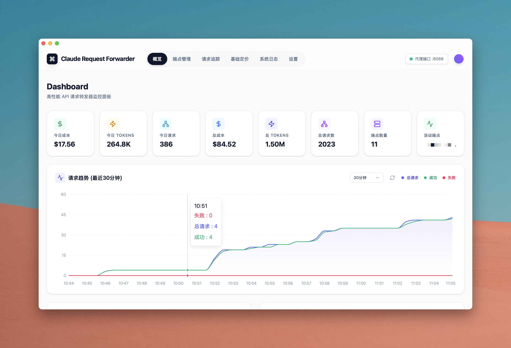

# Vane

> Local AI Gateway for Agents — routing, failover, and request observability.

<p align="center">
  
</p>

<p align="center">
  <strong>面向 AI 与 Agents 的本地请求网关与观测控制台</strong><br>
  多端点路由 · 请求分流与故障转移 · 请求追踪 · Token 与成本统计
</p>

<p align="center">
  
  
  
  
  
</p>

## 概述

Vane 是基于 Wails v3、Go 和 React 构建的桌面应用，为 Claude、Codex 等 AI 工具提供本地代理入口。通过统一管理渠道、凭证分组和端点，处理请求路由、流量分配、健康检查与故障转移，并记录请求链路、Token 用量和费用。

Vane 延续 AI Relay Forwarder / Claude Request Forwarder 的开发历史，以新品牌从 **1.0.0** 开始发布。原有 Git 提交历史保留，旧项目标签不迁入新仓库。

## 主要功能

- **多提供商接入**：Claude 与 Codex 分别管理，支持多渠道、凭证分组、多个上游端点。
- **请求路由与故障转移**：端点优先级、健康检查、重试预算、渠道级模型路由与逐次执行记录。
- **流式与非流式响应**：保留客户端请求语义；流式与非流式错误按各自协议处理。
- **请求追踪**：查看生命周期、端点尝试、耗时、上游状态及错误，辅助定位失败原因。
- **用量与费用**：统计 Token、缓存命中及成本；区分 provider 原始用量与可计费用量，按凭证分组倍率核算。
- **隐私设置**：提供脱敏规则与检测能力，设置范围及模式由应用内配置控制。
- **本地存储**：SQLite 保存配置与请求历史，支持归档和存储管理。
- **可视化管理**：在应用内管理客户端接入、渠道、凭证、端点、定价和运行设置。



## 下载与运行

发布后可从 [Vane Releases](https://github.com/wsyangzy/Vane/releases) 下载。

当前发布工作流打包 Windows x64，资产名称为 `Vane-windows-amd64.zip`。macOS、Linux 提供源码构建配置。

Windows 运行需要 Microsoft Edge WebView2 Runtime。解压后运行 `Vane.exe`，在应用中配置 Claude 或 Codex 的渠道、凭证和端点，再通过客户端接入入口预览并应用本地代理设置。代理地址与端口以应用实际设置为准。

## 从源码开发

需要 Go **1.25.0**、Node.js **20.19+ 或 22.12+**及 npm。Wails 使用项目固定的 `v3.0.0-alpha.96`；Windows 构建还需要可用的 C 编译器与 `goversioninfo`。

以下示例使用 PowerShell：

```powershell
git clone https://github.com/wsyangzy/Vane.git
cd Vane

# 安装项目使用的构建工具
go install github.com/wailsapp/wails/v3/cmd/wails3@v3.0.0-alpha.96
go install github.com/josephspurrier/goversioninfo/cmd/goversioninfo@v1.5.0

# 安装前端依赖并生成首次构建资源
Push-Location frontend
npm ci
npm run build
Pop-Location

# 启动桌面开发模式
wails3 task dev
```

Go module 为 `github.com/wsyangzy/Vane`。桌面入口通过 `desktop` build tag 编译，优先使用项目 Taskfile 构建。

```powershell
# 完整生产构建：前端、平台资源与桌面程序
wails3 task build

# 仅构建桌面开发程序
wails3 task dev:build
```

Windows 输出位于 `build/bin/Vane.exe`，开发版本为 `build/bin/Vane-dev.exe`。

## 配置与数据目录

运行设置由代码默认值初始化，并保存在应用自己的 SQLite 数据库中。渠道、凭证、端点、模型定价、代理、日志和故障转移等配置通过应用界面管理。

| 平台 | 默认应用数据目录 |
| --- | --- |
| Windows | `%APPDATA%\Vane` |
| macOS | `~/Library/Application Support/Vane` |
| Linux | `$XDG_DATA_HOME/Vane`，未设置时为 `~/.local/share/Vane` |

默认数据库位于数据目录下的 `data/usage.db`，日志位于 `logs/`。用户显式设置的自定义数据库路径继续按应用配置使用。

### 数据迁移

Vane 仅使用上述数据目录，不自动识别或回退到其他品牌目录。首次切换前关闭旧应用，将原应用数据目录整体迁移到 Vane；请保留完整数据库、SQLite 辅助文件、日志和追踪恢复文件，不要只复制 usage.db。

存在多份历史数据时，以当前使用的数据作为主目录；其他历史目录可独立保存到 Vane 下的 `archives/`，不会自动合并到当前数据库。迁移前备份，且不得覆盖已有 Vane 数据。

图标源文件为 `assets/vane.png`。安装 Pillow 后运行 `python scripts/assets/generate-icon.py`，可重新生成桌面、托盘、Windows、macOS、Linux 与网页图标。

## 项目结构

```text
Vane/
├── cmd/
│   ├── vane/                 # 桌面可执行程序入口
│   └── subscription-probe/         # 独立订阅诊断工具
├── internal/
│   ├── app/                        # 依赖装配、应用生命周期与业务编排
│   ├── buildinfo/                  # Version / Commit / BuildTime / BuildMode
│   ├── config/                     # 配置类型、默认值与校验
│   ├── desktop/
│   │   ├── host/                   # Wails、窗口、托盘与桌面集成
│   │   └── api/                    # 按功能拆分的 Wails 服务，复用 app DTO
│   ├── providers/
│   │   ├── claude/                 # Claude proxy / service / store / 客户端配置
│   │   └── codex/                  # Codex proxy / service / store / 客户端配置
│   ├── tracking/                   # 请求生命周期、用量、成本与归档
│   ├── pricing/                    # 模型定价与持久化
│   ├── routing/                    # 路由模型、规则与执行
│   ├── settings/                   # 应用设置及其持久化
│   ├── privacy/                    # 隐私检测与脱敏
│   ├── subscriptions/              # 订阅账号能力
│   └── platform/                   # 数据路径、日志、SQLite、监控等通用支持
├── frontend/
│   ├── assets.go                   # dist 资源的 Go embed 边界
│   └── src/
│       ├── app/                    # 应用入口、布局、全局状态与发布说明
│       ├── features/               # 功能页面、专属组件、hooks 与工具
│       ├── services/               # Wails 调用与显式数据映射
│       ├── shared/                 # 通用 UI、hooks、工具与资源
│       └── bindings/               # Wails v3 生成绑定
├── assets/                         # Go 嵌入的应用图标与托盘图标
├── build/                          # 平台资源、版本资源与 Wails 构建任务
├── scripts/
│   ├── build/                      # 本机构建与打包
│   ├── release/                    # 版本同步与发布说明生成
│   ├── assets/                     # 图标生成与 macOS 图标维护
│   └── checks/                     # 验证入口及发布脚本测试
├── tests/
│   ├── integration/                # 跨模块代理、追踪与计费回归
│   └── legacy/                     # 已退出当前运行链路的历史迁移检查
└── docs/images/                    # README 等文档图片
```

桌面入口只负责启动宿主，`internal/app/` 装配共享依赖并编排运行状态，`internal/desktop/api/` 将功能服务暴露给 Wails。Provider 的代理、凭证、激活、客户端配置和计费规则分别放在对应 provider 下；通用设施不承担 provider 业务规则。单元测试与被测 Go 包放在一起，跨模块场景保留在 `tests/integration/`。

前端按功能组织页面与局部组件，`services/` 是生成绑定与 UI 数据之间的显式映射边界。`bindings/` 由工具生成，修改后端签名或 DTO 后从仓库根目录重新生成，再检查映射、调用点与前端构建：

```powershell
wails3 task common:generate:bindings
```

首次生成需要已存在 `frontend/dist/`，可先运行前端构建。完整命令由 `build/Taskfile.yml` 维护；不要手工修改生成绑定。`build/wails.json` 只保留旧 Wails v2 配置兼容资料，现行构建以根 `Taskfile.yml`、`build/config.yml` 与平台 Taskfile 为准。

## 验证

前端命令在 `frontend/` 下运行：

```powershell
npm run lint
npm test
npm run build
```

后端与发布脚本命令在仓库根目录运行。Go 测试前需要存在 `frontend/dist/index.html`：

```powershell
go test ./...
go test -tags desktop -run '^$' ./...
python -B -m unittest discover -s scripts/checks -p "test_*.py"
git diff --check
```

开发时可按任务范围选择相应 provider 与共享模块的定向测试。`AGENTS.md` 和 `CLAUDE.md` 为本地 Agent 约束文件，不纳入版本控制。

## 发布与版本

Vane 使用三段版本号，初始版本为 `1.0.0`；Windows 文件资源采用对应的四段数字版本 `1.0.0.0`。版本权威值位于 `internal/buildinfo/buildinfo.go` 的 `Version`；Wails、平台资源、构建默认值和 `frontend/src/app/release-notes.json` 应与之保持一致。链接器注入使用 `github.com/wsyangzy/Vane/internal/buildinfo.Version` 等完整变量路径。

需要调整版本时，可在 Bash 环境运行 `bash scripts/release/release.sh <版本号> "发布说明"`，审核版本文件与发布说明后再单独提交。该脚本只更新文件；不自动提交、打标签或推送。

GitHub Actions 分为持续检查与标签发布：

| 工作流 | 触发条件 | 执行内容 |
| --- | --- | --- |
| [CI](.github/workflows/ci.yml) | 推送 `main`、Pull Request、手动检查，以及标签发布调用 | Go 格式与 vet、工作流语法、构建/发布脚本测试、前端 lint/测试/构建、Windows/macOS/Linux Go 测试及 desktop tag 编译检查 |
| [Release](.github/workflows/release.yml) | 推送 `vMajor.Minor.Patch` 发布标签 | 校验版本和发布说明，运行完整 CI，成功后编译 Windows x64 发布程序、校验版本资源、打包并发布 GitHub Release |

CI 对仅修改 Markdown 或 `docs/` 的 PR 保留检查名称，跳过前端和 Go 平台任务中的步骤。CI 使用只读仓库权限；PR 的新提交会取消同一 PR 的旧运行，每个任务均设置超时。普通提交、PR 与手动 CI 检查只产生测试所需的前端中间资源。

发布流程只接受三段数字版本标签，例如 `v1.0.0`，不提供手动发布入口。标签必须与 `internal/buildinfo/buildinfo.go`、发布说明的当前版本及版本条目一致；完整 CI 通过后才编译发布程序。发布资产为 `Vane-windows-amd64.zip` 和 `checksums.txt`，只有最终发布任务拥有仓库写入权限。

旧项目标签不随仓库迁移上传。旧历史中仅由标签引用的提交通过 `archive/legacy-history` 分支保留。

## 贡献与许可

欢迎通过 [Issues](https://github.com/wsyangzy/Vane/issues) 和 Pull Requests 提交反馈与改进。

项目采用 [MIT License](LICENSE)。原项目作者和贡献者的版权声明继续保留。

感谢原项目作者与贡献者，以及 [Wails](https://wails.io)、Go、React 和相关开源依赖。项目最初受 [xinhai-ai/endpoint_forwarder](https://github.com/xinhai-ai/endpoint_forwarder) 启发。
