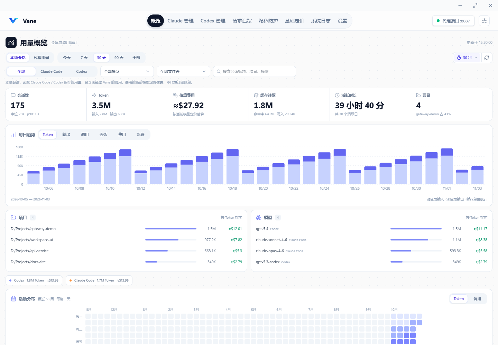
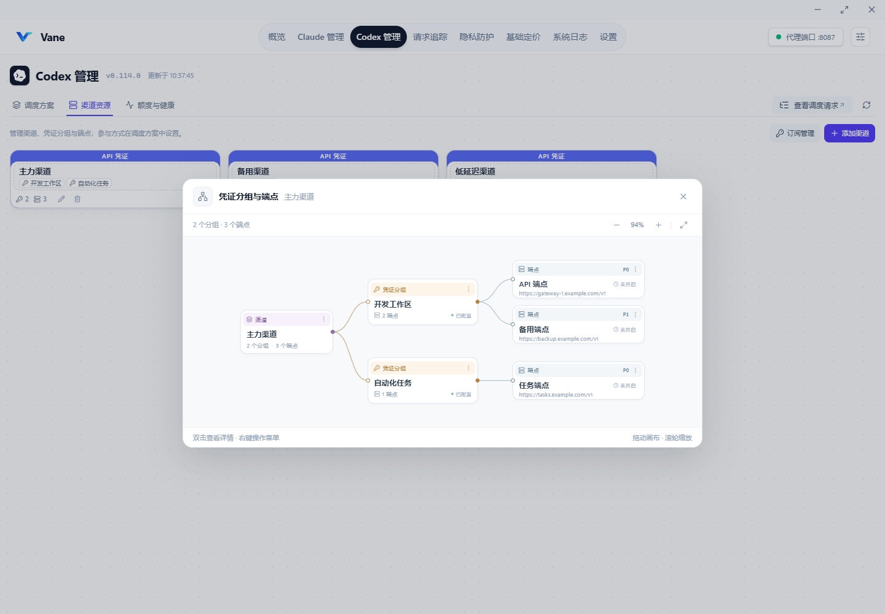
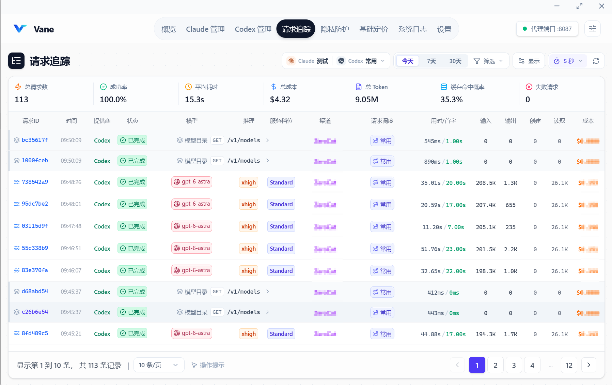
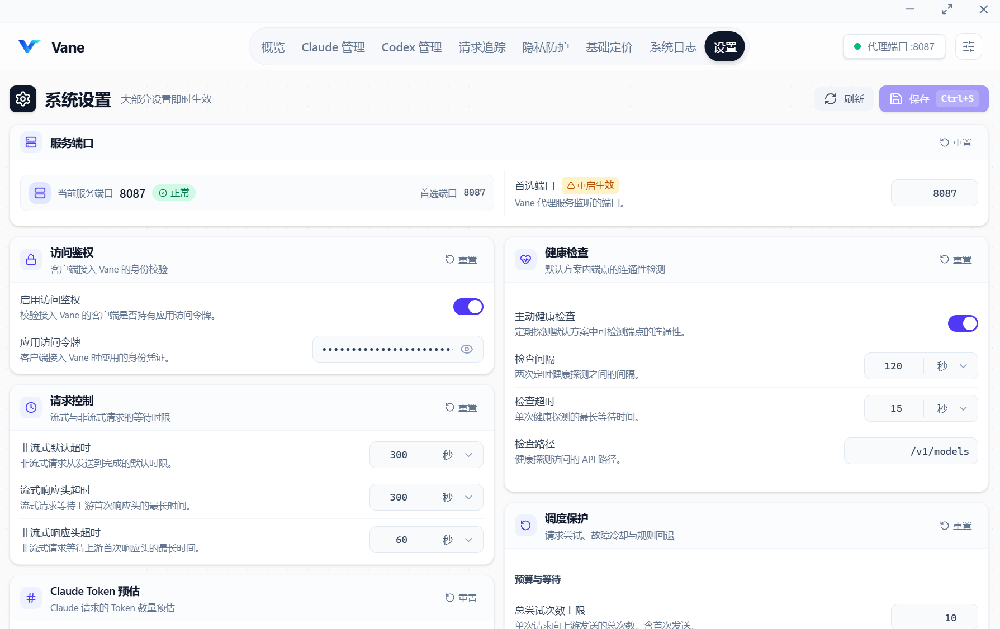

# Vane

<p align="center">
  
</p>

<p align="center">
  <strong>Claude 与 Codex 的本地代理与请求管理工具</strong><br>
  多端点管理 · 自动故障转移 · 请求追踪 · 用量与费用统计
</p>

<p align="center">
  
  
  
  
  
</p>

Vane 是一个本地桌面应用，集中管理 Claude、Codex 的 API 渠道、订阅账号与上游端点，自动处理请求路由和故障转移，并记录请求、Token 用量与费用。

## 下载与上手

从 [Releases](https://github.com/wsyangzy/Vane/releases) 下载 `Vane-windows-amd64.zip`，解压后运行 `Vane.exe`。Windows 需要 Microsoft Edge WebView2 Runtime；macOS、Linux 可从源码构建。

1. **添加渠道**：在 Claude 或 Codex 管理页填写 API 凭证，或登录、导入订阅账号，再配置上游端点。
2. **配置调度**：选择要使用的渠道和凭证分组，保存调度方案并设为默认。
3. **接入客户端**：打开「客户端配置」，预览并应用本地代理配置；Codex 应用配置后需重启。
4. **查看请求**：在请求追踪和用量概览中检查请求结果与费用。

代理地址和端口以应用中的设置为准。客户端配置支持备份与恢复，上游地址和凭证由 Vane 管理。

Claude、Codex 的「客户端配置」入口位于「调度方案」页。首次接入，或修改代理地址、鉴权、压缩方式和模型目录来源时，生成预览后点击「备份并应用配置」自动写入本机文件，再重启客户端。仅更新 Vane 调度规则、调整方案中的首选与参与渠道或切换默认方案时，新请求直接采用更新后的路由，无需重新生成客户端配置；改用客户端官方登录凭证时，需要重新应用对应接入模板。

Codex 的「会话压缩方式」统一在「客户端配置」中选择，适用于这个客户端接入的所有渠道。跨渠道路由默认使用「普通摘要」；「原生压缩」适用于参与路由的上游都支持该协议的会话；「保留客户端配置」沿用已应用的能力设置。选择后重新预览、备份并应用，再重启 Codex。旧渠道的压缩字段保留用于数据兼容，不再参与客户端配置生成或阻止混合路由。

原生压缩支持需根据上游说明或同一上游在压缩后继续请求的真实结果确认。健康检查或普通请求成功不能证明支持；当前没有自动检测或持久化的原生兼容性结论。请求中的压缩项与 `invalid tool type` 同时出现只说明可能有关，不能单独确定上游拒绝了哪种工具格式。

Codex 响应请求的「请求详情 → 概览 → 原生压缩验证」展示本次请求的压缩项数量、上游状态、端点、模型及验证结论，成功和失败请求都可查看。只有携带原生压缩项并收到完整上游成功结果时才显示「本次验证通过」；未携带或旧记录缺少信息显示「尚未验证」，上游失败也不直接认定为不支持。该区域可展开「请求格式诊断」，查看输入项和工具类型；复制错误信息时一并附带诊断。结论仅限本次请求的端点和模型，不汇总为整个渠道的兼容性承诺。

已保存的加密压缩、推理和响应状态不会被转换成普通摘要，切换渠道不保证另一上游能够读取这些状态。旧会话被拒绝时，需要使用支持原状态的上游，或在新会话补充必要背景。普通摘要不改变工具格式，也不代表上游协议已验证。请求详情保留上游错误与协议类型、数量诊断，不保存请求正文、工具参数或加密内容。

Codex 的 API 凭证端点支持选择「标准 /v1 路径」或「按 API 基础地址拼接」，表单会显示实际请求地址。「检测路径」只读取模型目录；需要确认生成接口时，可选择模型后主动执行一次「验证流式请求」，会产生少量用量。检测不会自动保存或切换路径，失败时仍可手动配置。已有端点升级后保持原有行为，编辑并选择明确的策略后才迁移；官方订阅继续使用固定路径。

请求追踪分别记录发送次数用尽、总时长耗尽，以及预计恢复时间超出剩余等待时间，并显示实际尝试次数和可用的恢复时间。相同提供商、调度范围和停止原因的失败通知在 30 秒内合并计数；每条请求仍独立保留在追踪记录中。

## 主要功能

- **渠道管理**：Claude、Codex 分别配置，支持 API 凭证、订阅账号与多个上游端点。
- **路由与容错**：按调度方案和规则分配请求，支持健康检查、失败重试和自动切换端点。
- **请求追踪**：查看请求状态、耗时、错误，以及每次路由和重试的过程。
- **用量与费用**：汇总本地会话和代理请求，查看 Token、缓存用量、模型分布和费用，支持自定义定价与倍率。
- **隐私防护**：支持敏感信息检测、发送前脱敏与回复还原，默认仅检测。
- **本地管理**：配置、日志和请求历史保存在本机，支持历史归档、缓存清理与存储管理。

## 应用界面

### 用量概览

查看本地会话与代理请求的 Token、费用和使用趋势。



### 渠道与调度方案

分别管理 Claude、Codex 渠道，用调度方案选择请求使用的资源与路由规则。



### 请求追踪

查看每次请求的结果、耗时、用量，以及路由和重试过程。



### 系统设置

统一设置重试次数、等待时限和故障冷却。



## 配置与数据

渠道、客户端接入、模型定价和运行设置均可在应用内管理。默认数据目录：

| 平台 | 数据目录 |
| --- | --- |
| Windows | `%APPDATA%\Vane` |
| macOS | `~/Library/Application Support/Vane` |
| Linux | `$XDG_DATA_HOME/Vane`，未设置时为 `~/.local/share/Vane` |

主数据库默认位于 `data/usage.db`，日志位于 `logs/`。可在「设置 → 数据保留」中查看实际路径、调整保留天数与历史归档位置。

迁移数据前请完全退出应用并备份完整数据目录。Vane 不会自动导入或合并旧品牌的数据。

## 从源码开发

技术栈：Go、Wails v3、SQLite、React 19、Vite 7、Tailwind CSS 4。

需要 Go **1.27.3**、Node.js **20.19+ 或 22.12+** 和 npm。以下为 Windows / PowerShell 示例，构建还需要可用的 C 编译器。

```powershell
git clone https://github.com/wsyangzy/Vane.git
cd Vane

# 安装固定版本的构建工具
go install github.com/wailsapp/wails/v3/cmd/wails3@v3.0.0-alpha.96
go install github.com/josephspurrier/goversioninfo/cmd/goversioninfo@v1.5.0

# 安装前端依赖，生成首次启动所需资源
Push-Location frontend
npm ci
npm run build
Pop-Location

# 启动桌面开发模式
wails3 task dev
```

运行 `wails3 task build` 构建生产版本，Windows 产物为 `build/bin/Vane.exe`。

主要代码位置：

| 目录 | 用途 |
| --- | --- |
| `cmd/vane/` | 桌面入口 |
| `internal/app/`、`internal/desktop/` | 应用编排与桌面服务 |
| `internal/providers/` | Claude、Codex 代理与业务逻辑 |
| `internal/tracking/`、`pricing/`、`routing/`、`privacy/` | 请求追踪、定价、路由与隐私防护，均位于 `internal/` 下 |
| `frontend/src/` | 页面、共享组件与 Wails 调用 |
| `build/`、`scripts/` | 构建、打包与发布工具 |

### 验证

```powershell
# 前端
Push-Location frontend
npm run lint
npm test
npm run build
Pop-Location

# 后端：需要先完成前端构建
go test ./...
go test -tags desktop -run '^$' ./...
```

更多测试入口见 [测试说明](tests/README.md)。后端 Wails 接口变更后，运行 `wails3 task common:generate:bindings` 更新绑定。

## 反馈与许可

欢迎通过 [Issues](https://github.com/wsyangzy/Vane/issues) 或 Pull Request 提交反馈与改进。

项目采用 [MIT License](LICENSE)，保留原项目作者和贡献者的版权声明。

## 鸣谢

感谢原项目作者、贡献者，以及以下项目的工作与启发：

- [xiaozhaodong/cc-forwarder](https://github.com/xiaozhaodong/cc-forwarder)：Claude API 转发与管理。
- [yetone/magpie](https://github.com/yetone/magpie)：AI 编程工具的桌面模型网关。
- [xinhai-ai/endpoint_forwarder](https://github.com/xinhai-ai/endpoint_forwarder)：项目最初的灵感来源。
- [Wails](https://wails.io)、[Go](https://go.dev)、[React](https://react.dev) 及相关开源依赖。
