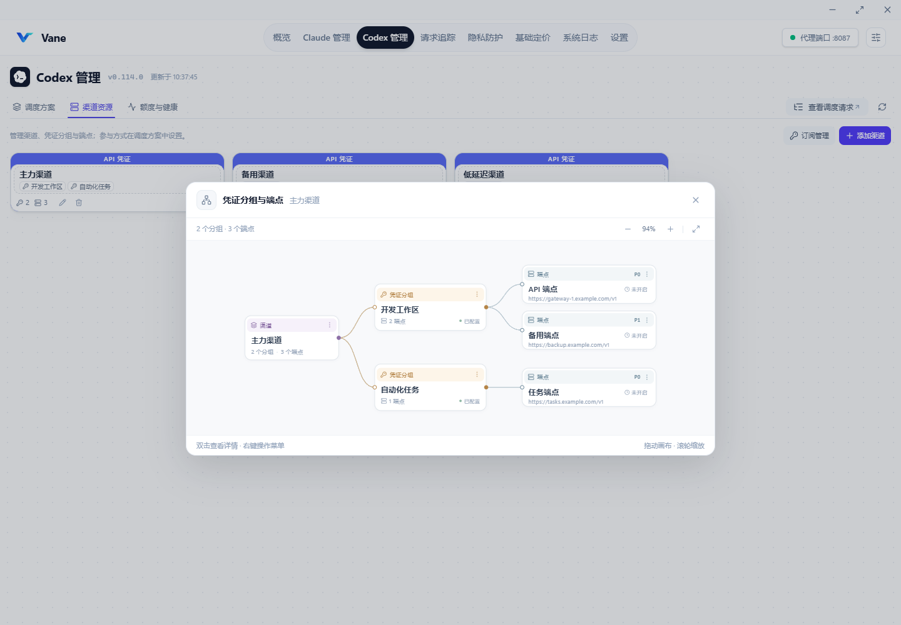
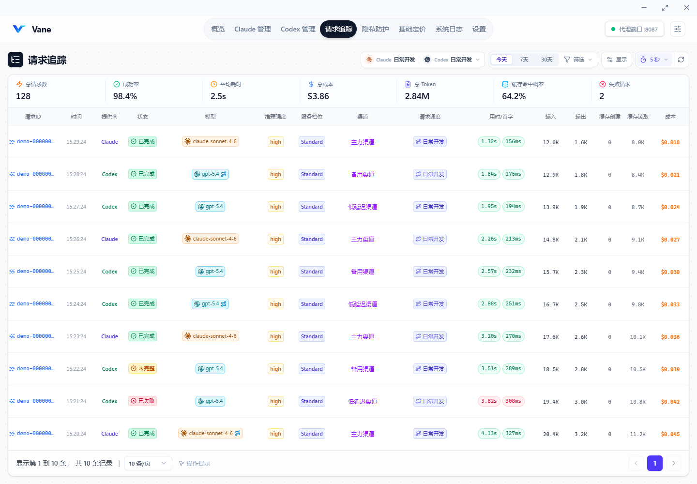
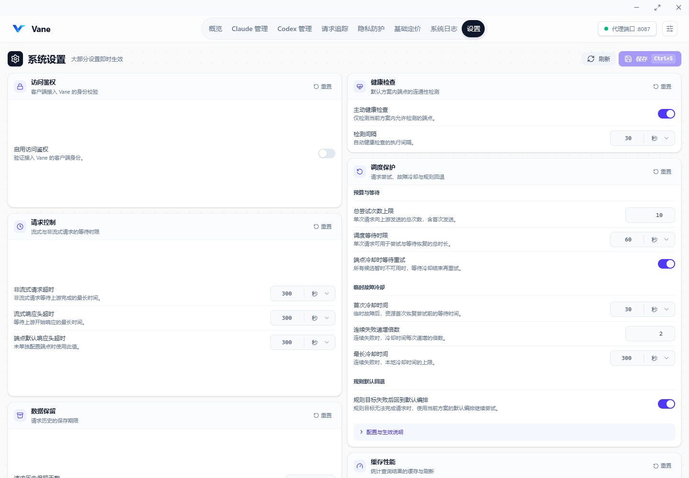

# Vane

> Local AI Gateway for Agents — routing, failover, and request observability.

<p align="center">
  
</p>

<p align="center">
  <strong>面向 AI 与 Agents 的本地请求网关与观测控制台</strong><br>
  多端点路由 · 请求分流与故障转移 · 请求追踪 · Token 与成本统计
</p>

<p align="center">
  
  
  
  
  
</p>

## 概述

Vane 是基于 Wails v3、Go 和 React 构建的桌面应用，为 Claude、Codex 等 AI 工具提供本地代理入口。通过统一管理渠道、凭证分组和端点，处理请求路由、流量分配、健康检查与故障转移，并记录请求链路、Token 用量和费用。

转发以保留客户端请求语义为原则：保留会话与客户端身份头，只替换选定接入所需的认证和目标地址；正文仅按显式模型映射及隐私规则处理。签名、加密内容和历史响应 ID 原样发送，本地记录只作为路由偏好，不因未知、过期或不同来源的历史状态拒绝续聊。修改方案后，下一个请求按最新方案重新决策；地址和凭证未变的端点重载保留运行时标识。代理不自动跟随上游重定向重放业务请求，需要将端点配置为实际 API 地址。启用意图识别会额外发送分类请求，健康探测和故障转移也可能产生额外网络请求。

Vane 延续 AI Relay Forwarder / Claude Request Forwarder 的开发历史，以新品牌从 **1.0.0** 开始发布。原有 Git 提交历史保留，旧项目标签不迁入新仓库。

自动健康探测仅覆盖各提供商当前默认调度方案的启用成员；未参与的渠道、分组和无可用凭证的资源显示“未开启”，不发送后台探测。没有启用的默认方案时不进行自动探测。设置中的“主动健康检查”为 Claude 与 Codex 共用的总开关，关闭后停止发起自动探测，端点显示“未开启”并隐藏旧延迟；手动检测和真实请求反馈仍可使用。切换方案或修改成员后按新范围执行；订阅端点始终通过真实请求验证。手动“立即检测”只执行一次，不开启自动检测；方案内“跳过健康检查”仍保留延迟测速，仅跳过健康判定。

「设置 → 调度保护」统一配置 Claude / Codex 的总尝试次数、调度等待时限、恢复等待、首次冷却时间、连续失败递增倍数与最长冷却时间，以及所有规则共用的一个默认回退开关。模型 / 条件路由、模型映射、非流改道和意图路由选择「跟随全局」时采用该配置，规则内明确的允许或禁止优先；已有方案保留自己的预算上限，与全局限制取较小值，新建方案从当前全局预算初始化。设置保存后生效；新的冷却参数用于后续失败，已进入冷却的资源保留原到期时间，正在处理的请求保留已采用的规则决策。上游有效的 `Retry-After` 优先于本地冷却时间，调度预算耗尽后停止等待与新尝试，不中断已开始的正常响应。

## 主要功能

- **多提供商接入**：Claude 与 Codex 分别管理，支持多渠道、凭证分组、多个上游端点。
- **请求路由与故障转移**：端点优先级、健康检查、重试预算、渠道级模型路由与逐次执行记录。
- **流式与非流式响应**：保留客户端请求语义；流式与非流式错误按各自协议处理。
- **请求追踪**：统一查看生命周期、调度决策、端点尝试、耗时、上游状态及错误；详情中的「高级诊断」可展开候选身份、状态版本与完整事件。Claude / Codex 管理中的「查看调度请求」会自动按提供商筛选，调度记录继续用于本地诊断和方案统计。
- **用量与费用**：统计 Token、缓存命中及成本；区分 provider 原始用量与可计费用量，按凭证分组倍率核算。
- **隐私防护**：统一管理密钥、个人信息、完整私钥和业务文本规则，顶部模式统一控制所有渠道；规则可设置额外放行，并在全局回复还原开启时选择是否还原，运行设置保留回复还原总开关、扫描上限与异常处理策略。
- **本地存储**：SQLite 保存配置与请求历史，支持归档和存储管理。
- **可视化管理**：在应用内管理客户端接入、渠道、凭证、端点、定价和运行设置。

请求列表中的「请求调度」显示本次采用的方案，多次尝试和未发送会单独标记。单击可预览决策与调用路径，再点击「查看完整调度」进入请求详情的调度链路页签；普通双击请求行仍从概览打开。

## 应用界面

以下截图来自 v1.0.1 的实际前端界面，使用示例渠道、请求和用量数据，不包含真实凭证或用户会话。

### 用量概览

按本地会话或代理请求查看 Token、费用、趋势与模型分布，支持按提供商、周期和项目筛选。


### 渠道与调度方案

Claude 与 Codex 分别管理渠道资源，通过调度方案组织渠道、凭证分组、路由规则和候选预览。



### 请求追踪

查看真实发送的渠道与端点、请求结果、Token 和费用；通过请求调度入口展开模型路由、重试与完整调用链。



### 调度保护设置

统一配置 Claude 与 Codex 的请求预算、恢复等待、临时故障冷却及规则默认回退，单条规则可以明确覆盖回退设置。



## 功能与行为说明

隐私防护默认仅检测，密钥预设需要在「导入预设」中启用。顶部「关闭」不扫描；「仅检测」记录命中，原文放行；「脱敏」统一替换敏感值，额外放行规则除外。运行设置中的「回复还原」独立控制回复文本和工具参数中的编码还原，不影响发送前脱敏。扫描出错或路径未覆盖时原文放行，可分别选择是否写入防护记录；还原映射超限时始终记录并原文放行。超过扫描上限时可选择扫描前缀、其余原样放行，或跳过整次扫描并原文放行；默认扫描前缀。隐私模块不主动拒绝请求。旧警告和拦截规则迁移为普通规则，跟随顶部模式。全部 Claude / Codex 渠道统一使用这一入口，旧渠道的可信／中转级别不再参与判断。同一请求的重试与故障转移复用同一份处理结果。

「防护规则」定义匹配内容、启停和优先级。脱敏模式下，规则编辑提供「额外放行」开关；未额外放行且全局回复还原开启时，显示「回复还原」开关，选择本规则是否还原回复。全局还原关闭时隐藏规则还原开关，原有选择会保留，重新开启后恢复。列表显示「回复还原」或「回复不还原」。额外放行规则豁免完整命中值，不参与检测、脱敏或回复还原，指定文本忽略大小写；仅检测模式隐藏规则处理选项。全局总开关不会覆盖单条规则关闭还原的选择，也不会让额外放行规则参与还原。关闭单条规则的还原不会影响发送前脱敏，也不会改变该规则在同一会话中的已有编码。不同规则的编码映射独立，避免可还原规则把另一条仅脱敏规则的值还原出来。运行设置支持修改单次请求累计可扫描文本的大小上限，以及出错、未覆盖路径和超限时的处理；不记防护记录仅影响所选异常，请求追踪仍照常记录。已有类别开关、类型动作、脱敏词和例外名单会合并为规则；旧占位符／假名替换迁移为稳定编码，保留匹配内容和启停，旧警告与拦截动作统一跟随顶部模式。

编码映射仅存本机内存、闲置一小时过期；没有明确会话标识时仅用于本次请求，重启后不会恢复旧映射。仅脱敏规则仍使用稳定编码，但其编码不会在回复中还原。映射容量不足时记录并原文放行，避免发送无法区分实体的占位符。签名、加密内容、工具定义与二进制载荷不改写。「防护记录」展示扫描、实际替换、截断及还原摘要，并区分总开关或规则关闭还原的情况，不保存命中原文、请求正文或映射，最多保留 30 天、5,000 条；旧版本的拒发摘要仍可查看。

Codex 组合计费将「分组基础倍率」与模型、服务档位和上下文规则分开配置。选择组合规则即自动适配档位，无需另选计费档位依据：显式请求的 Standard、Flex、Batch、Fast（含 priority 别名）或 Ultrafast 决定价格及规则匹配，请求为 Auto、未指定或未识别时采用响应档位。响应 default 不会覆盖明确请求的 Fast；档位仍未确定时保留原始记录，并使用 Standard 价格兜底。传统倍率固定使用 Standard 定价，只应用总倍率、分项倍率及已启用的 Long context 和模型倍率，不再选择计费档位依据；需要按服务档位计费时使用组合规则。每次只命中一条规则，模型、档位及上下文规则始终按 `单价 × 分组分项倍率 × 规则分项倍率 × 分组总倍率 × 规则总倍率` 计算；固定单价规则也叠加分组基础倍率，不提供独立计费开关。已有例外规则即使保存了旧的独立计费标记，也统一按叠加执行。编辑与分组详情只展示分组基础倍率和附加规则，不再展示默认兜底卡片；未配置附加规则时也可保存组合模式。旧默认规则保留内部兼容，载入时将与分组基础倍率完全相同的旧倍率合并为一次基础倍率，修改基础倍率不会重复相乘；不同的旧倍率或固定价保持原值。未命中任何规则时仍应用分组基础倍率。组合规则不再额外应用传统模型与 Long context 倍率；分组基础倍率中的 Long context 总开关决定是否使用长上下文价格与规则，关闭后始终按普通上下文计费。分项倍率编辑器按缓存写入计费选项展示 30m 或 30m / 12h 单价，两档共用缓存写入倍率；传统倍率的定价对照仅显示 Standard。请求绑定端点时保存自动匹配策略、分组基础倍率和规则，后续修改配置不影响这次请求；归档失败恢复时保留这些计费配置和缓存扣除口径。实时详情、归档计费与余额扣减使用相同的档位和价格选择逻辑。请求追踪列表默认显示服务档位列，与详情使用同一份计费快照；没有档位记录时显示破折号。请求详情使用当时落库的单价、倍率和策略快照，修改配置不会重算历史账单。

用量概览中，点击活动日会按该日筛选汇总、排名和明细，同时保留上方周期的趋势背景，不自动切换到全部历史。加载期间保留同一来源和提供商的上次结果，并标明正在更新；首次读取显示骨架屏。查询结果仅缓存在内存，最多保留 24 组、默认有效期 30 秒，较短的自动刷新间隔会缩短有效期；手动刷新重新读取当前来源。

会话明细以具体主题为标题，项目、模型和最近活跃时间作为辅助信息，右侧展示 Token 与估算费用。Claude 优先采用手动命名、AI 标题或会话摘要，Codex 优先读取原生会话名称索引；缺失时从首条有效用户消息提取最多 160 字符的脱敏短标题，跳过环境指令和工具内容，不额外调用模型。点击会话或「按项目查看」可打开项目分组明细，按完整目录区分同名项目；展开项目后独立分页读取当前筛选范围内的会话，不受主列表当前页限制。

原生会话文件首次采用最多 4 路并发解析，用量元数据索引保存在 Vane 数据目录的 `cache/local-usage-v1.gob`，重启后复用未变化文件的索引；文件变化、索引损坏或版本不兼容时自动重新解析。本次标题索引升级会触发一次重建。索引仅保留用量元数据与脱敏短标题，不保存完整消息正文、工具参数或凭证。两类缓存均受「启用缓存」控制，并在「缓存运行状态」中展示命中、占用和清理时间；清理本地索引也会使依赖它的概览查询缓存失效，原始会话不受影响。

## 下载与运行

当前版本为 **v1.0.1**，可从 [v1.0.1 发布页](https://github.com/wsyangzy/Vane/releases/tag/v1.0.1) 或 [全部 Releases](https://github.com/wsyangzy/Vane/releases) 下载。

当前发布工作流打包 Windows x64，资产名称为 `Vane-windows-amd64.zip`。macOS、Linux 提供源码构建配置。

Windows 运行需要 Microsoft Edge WebView2 Runtime。解压后运行 `Vane.exe`，在应用中配置 Claude 或 Codex 的渠道、凭证和端点，再通过客户端接入入口预览并应用本地代理设置。代理地址与端口以应用实际设置为准。

## 从源码开发

需要 Go **1.27.3**、Node.js **20.19+ 或 22.12+**及 npm。Wails 使用项目固定的 `v3.0.0-alpha.96`；Windows 构建还需要可用的 C 编译器与 `goversioninfo`。

以下示例使用 PowerShell：

```powershell
git clone https://github.com/wsyangzy/Vane.git
cd Vane

# 安装项目使用的构建工具
go install github.com/wailsapp/wails/v3/cmd/wails3@v3.0.0-alpha.96
go install github.com/josephspurrier/goversioninfo/cmd/goversioninfo@v1.5.0

# 安装前端依赖并生成首次构建资源
Push-Location frontend
npm ci
npm run build
Pop-Location

# 启动桌面开发模式
wails3 task dev
```

Go module 为 `github.com/wsyangzy/Vane`。桌面入口通过 `desktop` build tag 编译，优先使用项目 Taskfile 构建。

```powershell
# 完整生产构建：前端、平台资源与桌面程序
wails3 task build

# 仅构建桌面开发程序
wails3 task dev:build
```

Windows 输出位于 `build/bin/Vane.exe`，开发版本为 `build/bin/Vane-dev.exe`。

## 配置与数据目录

运行设置由代码默认值初始化，并保存在应用自己的 SQLite 数据库中。渠道、凭证、端点、模型定价、代理、日志和故障转移等配置通过应用界面管理。

设置页的“调度保护”统一控制 Claude 与 Codex。“端点冷却时等待重试”默认开启，所有候选暂时不可用时，在本次请求剩余的调度时限和尝试次数内等待恢复；关闭后直接返回失败。保存后对新请求生效，已有方案的旧等待开关不再决定运行行为。方案自身的时间和次数限制与全局上限取较小值；客户端取消会结束等待，已经开始的正常响应不受调度时限中断。

| 平台 | 默认应用数据目录 |
| --- | --- |
| Windows | `%APPDATA%\Vane` |
| macOS | `~/Library/Application Support/Vane` |
| Linux | `$XDG_DATA_HOME/Vane`，未设置时为 `~/.local/share/Vane` |

默认数据库位于数据目录下的 `data/usage.db`，日志位于 `logs/`。用户显式设置的自定义数据库路径继续按应用配置使用。

“日志设置”可配置文件日志开关、单文件轮转大小、每类日志的归档保留数量及归档压缩，保存后即时生效，重启后保留。关闭文件日志仍可查看运行期间的实时日志；归档数量限制在后续轮转时清理超额文件，不会在保存设置时立即删除历史归档。

### 订阅账号登录与导入

在 Claude 或 Codex 管理页打开「订阅管理 → 订阅账号」：

- Codex 的「浏览器登录」由 Vane 生成独立的 OAuth/PKCE 授权会话并打开官方页面，无需安装 Codex CLI。官方回调地址为 `http://localhost:1455/auth/callback`；端口被占用或保留时，可将浏览器最后停留的完整回调 URL 粘贴到登录面板完成授权。
- Codex 的「设备码登录」需要已安装官方 Codex CLI。面板显示官方验证地址及设备验证码。
- Claude 登录需要已安装官方 Claude Code。Vane 在独立临时配置目录运行 `claude auth login --claudeai`，捕获并打开它的官方授权链接，支持自动回调、回调 URL 补交及 CLI 提供的完整授权码。
- 登录面板支持复制链接、重新打开浏览器和取消登录。CLI 使用 Vane 的全局代理配置，SOCKS5 经本地临时 HTTP CONNECT 桥接；浏览器使用自身网络设置。取消或超时不会保存尚未完成的登录。
- 「导入凭证」支持选择文件或粘贴单个账号 JSON，包括 Codex 的 ChatGPT `auth.json`、Claude Code 的 `.credentials.json` 和 CLIProxyAPI 的对应账号文件；需要完整的 access token 与 refresh token。Claude 文件缺少账号 UUID/邮箱时，需补充该凭证对应的邮箱，避免将轮换的 token 当成账号身份。
- 导入只读取并加密保存显式提供的内容，不代表已在线验证可用性；访问凭证按需刷新。与原工具共用刷新凭证可能导致其中一方需要重新登录，建议使用独立登录。

凭证使用当前 Windows 用户的 DPAPI 加密存储。登录和导入不会改写用户原有的 Codex/Claude 登录文件；临时登录目录和子进程在会话结束后清理。

### 数据迁移

Vane 仅使用上述数据目录，不自动识别、回退或合并其他品牌目录，也不会从 `usage-dev.db`、`usage-v2.db` 或程序运行目录导入数据。新目录首次启动时创建独立数据库。

从 RelayScope 切换时，先完全退出两边应用（包括托盘），并备份已有 Vane 目录；将 RelayScope 应用数据目录的完整副本放入 Vane，其中数据库必须位于 `Vane/data/usage.db`。请保留 SQLite 辅助文件、月度归档、日志和追踪恢复文件；不要向正在运行的应用目录覆盖数据库，也不要将旧库与新库的 `-wal`、`-shm` 文件混用。数据库可使用 SQLite backup API 生成包含已提交 WAL 数据的一致副本，迁入前后检查完整性和关键表记录数。

迁移完成后，Vane 直接使用自己的数据库，旧目录只作为备份。存在多份历史数据时，以当前使用的数据作为迁移来源，其余历史库独立保留，不自动合并或覆盖当前数据。

图标源文件为 `assets/vane.png`。安装 Pillow 后运行 `python scripts/assets/generate-icon.py`，可重新生成桌面、托盘、Windows、macOS、Linux 与网页图标。

## 项目结构

```text
Vane/
├── cmd/
│   ├── vane/                 # 桌面可执行程序入口
│   └── subscription-probe/         # 独立订阅诊断工具
├── internal/
│   ├── app/                        # 依赖装配、应用生命周期与业务编排
│   ├── buildinfo/                  # Version / Commit / BuildTime / BuildMode
│   ├── config/                     # 配置类型、默认值与校验
│   ├── desktop/
│   │   ├── host/                   # Wails、窗口、托盘与桌面集成
│   │   └── api/                    # 按功能拆分的 Wails 服务，复用 app DTO
│   ├── providers/
│   │   ├── claude/                 # Claude proxy / service / store / 客户端配置
│   │   └── codex/                  # Codex proxy / service / store / 客户端配置
│   ├── tracking/                   # 请求生命周期、用量、成本与归档
│   ├── pricing/                    # 模型定价与持久化
│   ├── routing/                    # 路由模型、规则与执行
│   ├── settings/                   # 应用设置及其持久化
│   ├── privacy/                    # 隐私检测与脱敏
│   ├── subscriptions/              # 订阅账号能力
│   └── platform/                   # 数据路径、日志、SQLite、监控等通用支持
├── frontend/
│   ├── assets.go                   # dist 资源的 Go embed 边界
│   └── src/
│       ├── app/                    # 应用入口、布局、全局状态与发布说明
│       ├── features/               # 功能页面、专属组件、hooks 与工具
│       ├── services/               # Wails 调用与显式数据映射
│       ├── shared/                 # 通用 UI、hooks、工具与资源
│       └── bindings/               # Wails v3 生成绑定
├── assets/                         # Go 嵌入的应用图标与托盘图标
├── build/                          # 平台资源、版本资源与 Wails 构建任务
├── scripts/
│   ├── build/                      # 本机构建与打包
│   ├── release/                    # 版本同步与发布说明生成
│   ├── assets/                     # 图标生成与 macOS 图标维护
│   └── checks/                     # 验证入口及发布脚本测试
├── tests/
│   ├── integration/                # 跨模块代理、追踪与计费回归
│   └── legacy/                     # 已退出当前运行链路的历史迁移检查
└── docs/images/                    # README 等文档图片
```

桌面入口只负责启动宿主，`internal/app/` 装配共享依赖并编排运行状态，`internal/desktop/api/` 将功能服务暴露给 Wails。Provider 的代理、凭证、激活、客户端配置和计费规则分别放在对应 provider 下；通用设施不承担 provider 业务规则。单元测试与被测 Go 包放在一起，跨模块场景保留在 `tests/integration/`。

前端按功能组织页面与局部组件，`services/` 是生成绑定与 UI 数据之间的显式映射边界。`bindings/` 由工具生成，修改后端签名或 DTO 后从仓库根目录重新生成，再检查映射、调用点与前端构建：

```powershell
wails3 task common:generate:bindings
```

首次生成需要已存在 `frontend/dist/`，可先运行前端构建。完整命令由 `build/Taskfile.yml` 维护；不要手工修改生成绑定。`build/wails.json` 只保留旧 Wails v2 配置兼容资料，现行构建以根 `Taskfile.yml`、`build/config.yml` 与平台 Taskfile 为准。

## 验证

前端命令在 `frontend/` 下运行：

```powershell
npm run lint
npm test
npm run build
```

后端与发布脚本命令在仓库根目录运行。Go 测试前需要存在 `frontend/dist/index.html`：

```powershell
go test ./...
go test -tags desktop -run '^$' ./...
python -B -m unittest discover -s scripts/checks -p "test_*.py"
git diff --check
```

开发时可按任务范围选择相应 provider 与共享模块的定向测试。`AGENTS.md` 和 `CLAUDE.md` 为本地 Agent 约束文件，不纳入版本控制。

## 发布与版本

Vane 使用三段版本号，当前版本为 `1.0.1`；Windows 文件资源采用对应的四段数字版本 `1.0.1.0`。版本权威值位于 `internal/buildinfo/buildinfo.go` 的 `Version`；Wails、平台资源、构建默认值和 `frontend/src/app/release-notes.json` 应与之保持一致。链接器注入使用 `github.com/wsyangzy/Vane/internal/buildinfo.Version` 等完整变量路径。

需要调整版本时，可在 Bash 环境运行 `bash scripts/release/release.sh <版本号> "发布说明"`，审核版本文件与发布说明后再单独提交。该脚本只更新文件；不自动提交、打标签或推送。

GitHub Actions 分为持续检查与标签发布：

| 工作流 | 触发条件 | 执行内容 |
| --- | --- | --- |
| [CI](.github/workflows/ci.yml) | 推送 `main`、Pull Request、手动检查，以及标签发布调用 | Go 格式与 vet、工作流语法、构建/发布脚本测试、前端 lint/测试/构建、Windows/macOS/Linux Go 测试及 desktop tag 编译检查 |
| [Release](.github/workflows/release.yml) | 推送 `vMajor.Minor.Patch` 发布标签 | 校验版本和发布说明，运行完整 CI，成功后编译 Windows x64 发布程序、校验版本资源、打包并发布 GitHub Release |

CI 对仅修改 Markdown 或 `docs/` 的 PR 保留检查名称，跳过前端和 Go 平台任务中的步骤。CI 使用只读仓库权限；PR 的新提交会取消同一 PR 的旧运行，每个任务均设置超时。普通提交、PR 与手动 CI 检查只产生测试所需的前端中间资源。

发布流程只接受三段数字版本标签，例如 `v1.0.1`，不提供手动发布入口。标签必须与 `internal/buildinfo/buildinfo.go`、发布说明的当前版本及版本条目一致；完整 CI 通过后才编译发布程序。发布资产为 `Vane-windows-amd64.zip` 和 `checksums.txt`，只有最终发布任务拥有仓库写入权限。

旧项目标签不随仓库迁移上传。旧历史中仅由标签引用的提交通过 `archive/legacy-history` 分支保留。

## 贡献与许可

欢迎通过 [Issues](https://github.com/wsyangzy/Vane/issues) 和 Pull Requests 提交反馈与改进。

项目采用 [MIT License](LICENSE)。原项目作者和贡献者的版权声明继续保留。

## 鸣谢

感谢原项目作者、贡献者和以下开源项目的工作与启发：

- [xiaozhaodong/cc-forwarder](https://github.com/xiaozhaodong/cc-forwarder)：使用 Go 实现的 Claude API 智能转发器，提供 Web 管理、请求追踪、分组管理与自动故障转移。
- [yetone/magpie](https://github.com/yetone/magpie)：面向 AI 编程工具的桌面模型网关，将不同模型接入集中到统一入口。
- [xinhai-ai/endpoint_forwarder](https://github.com/xinhai-ai/endpoint_forwarder)：项目最初的灵感来源。
- [Wails](https://wails.io)、[Go](https://go.dev)、[React](https://react.dev) 及相关开源依赖：支撑桌面宿主、代理运行时与应用界面。
